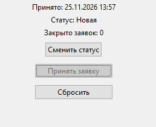
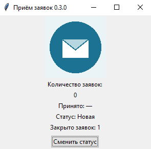
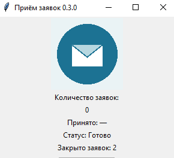
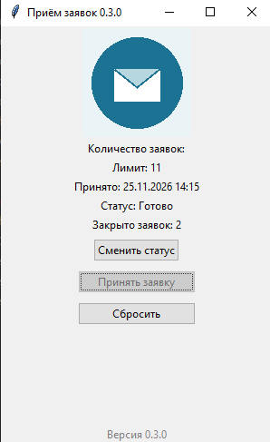
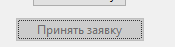

# Обработка обращений поддержки и база знаний

В рамках задания выполнена классификация 6 обращений кассиров по программе «Приём заявок», назначены приоритеты и линии поддержки, составлены 6 статей базы знаний и проведена проверка поиска.

## Содержимое проекта
* `contact.md` — таблица с классификацией и ответами на 6 обращений кассиров.
* `otchet.md` — база знаний (6 статей) и таблица проверки поиска по ключевым словам.

## Скриншоты обработки обращений

## 1. Кнопка «Принять заявку» серая 

## 2. Не знаю, как сменить статус   

## 3. Что значит закрыто заявок ?

## 4. Программа не запускается на кассе 

## 5. Кнопка «Принять заявку» серая (магазин 2) 

## 6. Не могу сменить статус
 